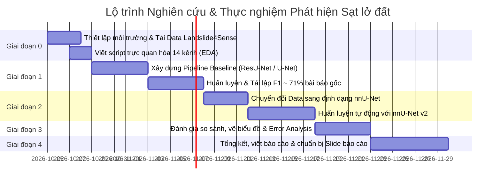

# LỘ TRÌNH NGHIÊN CỨU & THỰC HIỆN DỰ ÁN PHÁT HIỆN SẠT LỞ ĐẤT
## (Landslide Detection using Deep Learning & Multi-Source Satellite Imagery)

---

## 📌 I. TỔNG QUAN DỰ ÁN & MỤC TIÊU CỐT LÕI

* **Bài toán:** Phân đoạn ngữ nghĩa (Semantic Segmentation) phát hiện vùng sạt lở đất trên ảnh viễn thám đa nguồn.
* **Mục tiêu trực tiếp từ Giảng viên:** Tái lập (Reproduce) bài báo chuẩn quốc tế **Landslide4Sense (2022)**, huấn luyện mô hình học sâu đạt chỉ số F1-Score tương đương bài báo gốc:
  * **Baseline U-Net:** $F_1 \approx 67.8\% - 68.5\%$
  * **Target ResU-Net (Mục tiêu cần đạt):** $F_1 \approx \mathbf{71.65\%}$ (Precision: $\sim 78\%$, Recall: $\sim 66\%$)
* **Dữ liệu mục tiêu:** Bộ dữ liệu đa kênh **Landslide4Sense** (14 kênh, kích thước $128 \times 128$).

---

## 📚 II. HỆ THỐNG HÓA TÀI LIỆU VÀ CÔNG CỤ CỦA GIẢNG VIÊN

| Tài liệu / Link | Phân loại | Vai trò trong dự án | Hành động cụ thể |
| :--- | :--- | :--- | :--- |
| **[MDPI 2024](https://www.mdpi.com/2072-4292/16/16/2947)** | Review Paper | Bức tranh tổng quan về AI & Viễn thám trong sạt lở | Đọc lướt phần cơ sở lý thuyết, trích dẫn khi viết báo cáo |
| **[China Geology 2024](http://chinageology.cgs.cn/en/article/doi/10.31035/cg2024032)** | Review Paper | Cẩm nang kỹ thuật về Deep Learning cho sạt lở | Tra cứu các cấu trúc mạng (U-Net, ResU-Net, TransUNet) và hàm loss |
| **[Landslide4Sense (DLR)](https://elib.dlr.de/190006/1/Landslide4Sense_09944085.pdf)** | **Benchmark Paper** | **BÀI BÁO GỐC CẦN REPRODUCE** | **Đọc kỹ Section III & IV**, bám sát bảng kết quả thực nghiệm |
| **[fauzan9585/LandslideDetection-GEE](https://github.com/fauzan9585/LandslideDetection-GEE)** | Code Repo (GEE) | Baseline truyền thống (Random Forest) trên Google Earth Engine | Tham khảo nếu cần so sánh DL với ML cổ điển hoặc tải ảnh vệ tinh GEE |
| **[claim-berlin/aSAH-multiclass-segmentation](https://github.com/claim-berlin/aSAH-multiclass-segmentation)** | Code Repo | Cấu trúc dự án mẫu ứng dụng **nnU-Net** | Học cách tổ chức code, format dữ liệu chuẩn mực cho nnU-Net |
| **[MIC-DKFZ/nnUNet](https://github.com/MIC-DKFZ/nnUNet)** | Framework | Công cụ SOTA tự động tối ưu phân đoạn ảnh | Dùng làm pipeline tự động để đạt F1-Score vượt trội |

---

## 🗂️ III. BẢNG XẾP HẠNG TOP 10 BỘ DỮ LIỆU SẠT LỞ ĐẤT TOÀN CẦU

*(Tổng hợp từ cơ sở dữ liệu nghiên cứu chuyên ngành)*

| Rank | Dataset Name | Vệ tinh / Cảm biến chính | Độ phân giải | Số lượng mẫu (Images / Patches) | Phạm vi địa lý | Kiểu bài toán | Đặc điểm nổi bật / Ghi chú | Nguồn truy cập |
| :---: | :--- | :--- | :---: | :---: | :--- | :--- | :--- | :--- |
| **1** | **Landslide4Sense** | Sentinel-2 + ALOS PALSAR slope/DEM | 10 m | ~3,799 train + 245 val + 800 test | Toàn cầu (Nhiều châu lục) | Semantic segmentation | **Dataset benchmark phổ biến nhất**; đa cảm biến (14 bands); cuộc thi IARAI 2022 | [IARAI / Zenodo / Hugging Face](https://www.iarai.ac.at/landslide4sense/) |
| **2** | **HR-GLDD** | PlanetScope + vệ tinh HR khác | ~3 m | Hàng nghìn vết sạt lở | Toàn cầu (Châu Á, Mỹ Latinh,...) | Semantic segmentation | Độ phân giải cao; gồm sạt lở do mưa bão & động đất | [Zenodo / Copernicus ESSD](https://essd.copernicus.org/articles/15/3283/2023/) |
| **3** | **Sen12Landslides** | Sentinel-1 (SAR) + Sentinel-2 + DEM | 10 m | ~12,000 patches / 75,000 nhãn | 15 vùng địa lý toàn cầu | Spatio-temporal segmentation | Đa phương thức & chuỗi thời gian; phát hiện biến động | *Nature Scientific Data (2025)* |
| **4** | **CAS Landslide** | Đa vệ tinh + UAV | Đa dạng (HR đến VHR) | 20,865 ảnh | 9 vùng (chủ yếu Trung Quốc) | Detection & segmentation | Quy mô rất lớn; viện Hàn lâm Khoa học TQ (CAS) | *Scientific Data (Nature)* |
| **5** | **LMHLD** | IKONOS, RapidEye, Sentinel-2, Gaofen-2 | 0.8–10 m | 25,365 tiles | 7 thảm họa lớn (Wenchuan, Gorkha,...) | Semantic segmentation | Đa độ phân giải & đa sự kiện; hình thái sạt lở phong phú | [Zenodo (record/11519933)](https://zenodo.org/records/11519933) |
| **6** | **Bijie Dataset** | Gaofen-2 | ~1 m | Hàng trăm - hàng nghìn | Vùng Tất Tiết (Bijie, TQ) | Detection & segmentation | Một trong những bộ dataset HR mở đầu tiên | GitHub / Paper repositories |
| **7** | **LRSTTC** | Vệ tinh quang học độ phân giải cao | High res | Lớn (theo tuyến) | Hành lang giao thông Tứ Xuyên - Tây Tạng | Semantic segmentation | Dành riêng cho an toàn hành lang giao thông miền núi | MDPI / Remote Sensing |
| **8** | **Ludan / Wenchuan / Zhouqu** | Gaofen-2 và các vệ tinh khác | 1–4 m | Tùy từng đợt | Trung Quốc (nhiều sự kiện) | Cross-domain segmentation | Thường dùng để đánh giá độ thích nghi miền (Domain Adaptation) | GitHub / Liên hệ tác giả |
| **9** | **Bijie + Merged Datasets** | Đa dạng vệ tinh HR | 1–4 m | Linh hoạt | Chủ yếu Trung Quốc | Segmentation | Kết hợp Bijie với các tập dữ liệu nhỏ | Kaggle / GitHub |
| **10** | **Custom Regional Datasets** | PlanetScope, Sentinel-2,... | 3–10 m | Linh hoạt | Các vùng cụ thể (Hokkaido, Ý,...) | Segmentation | Các tập dữ liệu địa phương công bố giai đoạn 2023–2025 | Zenodo / Paper supplements |

> **Quyết định chiến lược:** Tập trung $100\%$ vào **Rank 1: Landslide4Sense** để hoàn thành yêu cầu tái lập bài báo của giảng viên trước khi mở rộng.

---

## 🚀 IV. LỘ TRÌNH 5 GIAI ĐOẠN TRIỂN KHAI THỰC CHIẾN



---

### Giai đoạn 0: Khởi động, Khám phá Dữ liệu & Môi trường (Ngày 1 - 3)
1. **Thiết lập môi trường làm việc:**
   * Cài đặt Python 3.10+, PyTorch (hỗ trợ CUDA nếu có GPU).
   * Các thư viện cần thiết: `h5py`, `numpy`, `matplotlib`, `albumentations`, `segmentation-models-pytorch`, `scikit-learn`.
2. **Tải Dataset Landslide4Sense:**
   * Tải tập Train (`~3799` patches) và Validation (`~245` patches) file `.h5`.
3. **Thực hiện EDA (Exploratory Data Analysis):**
   * Hiển thị tổ hợp màu tự nhiên (True Color: B04, B03, B02).
   * Hiển thị màu giả thực vật (False Color: B08, B04, B03).
   * Hiển thị kênh độ cao (DEM) và độ dốc (Slope).
   * Hiển thị mặt nạ sạt lở (Ground Truth Label).

---

### Giai đoạn 1: Tái lập Baseline PyTorch (Mục tiêu F1 ~ 71.65%) (Tuần 1 - 2)
1. **Tiền xử lý & Data Loader:**
   * Viết class `LandslideDataset(torch.utils.data.Dataset)`.
   * Chuẩn hóa giá trị 14 kênh: Min-Max Normalization hoặc Z-score riêng biệt cho các kênh quang học và kênh địa hình.
2. **Kiến trúc mô hình:**
   * Xây dựng **ResU-Net** (ResNet backbone + U-Net decoder) nhận đầu vào `in_channels=14`, đầu ra `classes=1`.
3. **Chiến lược Loss Function (Giải quyết Class Imbalance):**
   * Vì sạt lở chiếm diện tích rất nhỏ, kết hợp:
     $$\mathcal{L}_{total} = \alpha \mathcal{L}_{BCE} + \beta \mathcal{L}_{Dice}$$
4. **Huấn luyện & Đánh giá:**
   * Optimizer: AdamW, Learning Rate: $1e-4$, CosineAnnealingLR.
   * Tính toán các chỉ số trên tập Validation: Precision, Recall, F1-Score, IoU.

---

### Giai đoạn 2: Nâng cấp với nnU-Net (Ý tưởng cốt lõi của Thầy) (Tuần 3 - 4)
1. **Tại sao dùng nnU-Net?**
   * nnU-Net là chuẩn mực cao nhất trong phân đoạn ảnh, tự thiết kế cấu trúc mạng và tự chọn augmentation tối ưu.
2. **Chuyển đổi dữ liệu sang định dạng nnU-Net v2:**
   * Tham khảo cách cấu trúc thư mục từ repo [aSAH-multiclass-segmentation](https://github.com/claim-berlin/aSAH-multiclass-segmentation).
   * Định dạng mỗi mẫu sạt lở gồm 14 kênh (`_0000.png` đến `_0013.png` hoặc file `.tif/.npy/nii.gz`).
3. **Chạy Pipeline nnU-Net:**
   * `nnUNetv2_plan_and_preprocess -d Dataset001_Landslide`
   * `nnUNetv2_train 001 2d 0` (huấn luyện U-Net 2D trên fold 0).
4. **Kỳ vọng:** F1-score có thể nâng từ $71.65\%$ lên $\ge 73 - 75\%$.

---

### Giai đoạn 3: Phân tích Kết quả & Đào sâu Lỗi (Error Analysis) (Tuần 5)
1. **Lập bảng so sánh định lượng:**
   * So sánh kết quả của: U-Net chuẩn vs ResU-Net tự viết vs nnU-Net vs Bảng Table trong bài báo gốc.
2. **Phân tích định tính (Visual Inspection):**
   * Xuất ảnh dự đoán: So sánh ảnh gốc $\leftrightarrow$ Đáp án Ground Truth $\leftrightarrow$ Dự đoán của AI.
   * Tìm hiểu các ca mô hình đoán sai (False Positive do đất nông nghiệp cày xới, False Negative do sạt lở bị cây che khuất).

---

### Giai đoạn 4: Viết Báo cáo Khoa học & Báo cáo với Thầy (Tuần 6+)
1. Bố cục bài báo cáo/khóa luận:
   * **Chương 1:** Giới thiệu bài toán & Tổng quan tài liệu (dẫn dắt từ bài MDPI 2024).
   * **Chương 2:** Dữ liệu nghiên cứu (Phân tích bộ dữ liệu Landslide4Sense 14 kênh).
   * **Chương 3:** Phương pháp đề xuất (ResU-Net baseline & nnU-Net pipeline).
   * **Chương 4:** Thực nghiệm & Thảo luận (Bảng số liệu F1, Precision, Recall tái lập thành công).
   * **Chương 5:** Kết luận & Hướng phát triển (Thử nghiệm mở rộng trên dữ liệu Việt Nam hoặc HR-GLDD).

---

## 📂 V. CẤU TRÚC THƯ MỤC DỰ ÁN ĐỀ XUẤT

```text
d:/Detect/
├── data/
│   ├── raw/                  # File zip/h5 tải từ Landslide4Sense
│   ├── train/                # Dữ liệu huấn luyện
│   └── val/                  # Dữ liệu kiểm thử
├── notebooks/
│   ├── 01_explore_data.ipynb # Notebook trực quan hóa 14 kênh & nhãn
│   └── 02_evaluate.ipynb     # Notebook vẽ đồ thị so sánh kết quả
├── src/
│   ├── dataset.py            # PyTorch Dataset đọc file .h5
│   ├── models/               # Định nghĩa mạng U-Net, ResU-Net
│   ├── losses.py             # Dice Loss, Focal Loss, BCE Loss
│   ├── train.py              # Script huấn luyện
│   └── metrics.py            # Hàm tính Precision, Recall, F1, IoU
├── nnunet_conversion/        # Script chuyển đổi data sang định dạng nnU-Net
├── results/                  # Checkpoints mô hình và biểu đồ kết quả
├── README.md
└── ROADMAP.md                # Bản kế hoạch này
```

---

## 💡 VI. CHECKLIST CẦN THỰC HIỆN NGAY

- [ ] Tạo môi trường ảo: `python -m venv venv` và kích hoạt.
- [ ] Tải bộ dữ liệu **Landslide4Sense** (Train + Val).
- [ ] Chạy script đọc thử 1 file `.h5` và vẽ ảnh lên màn hình.
- [ ] Chạy mô hình Baseline đầu tiên.
