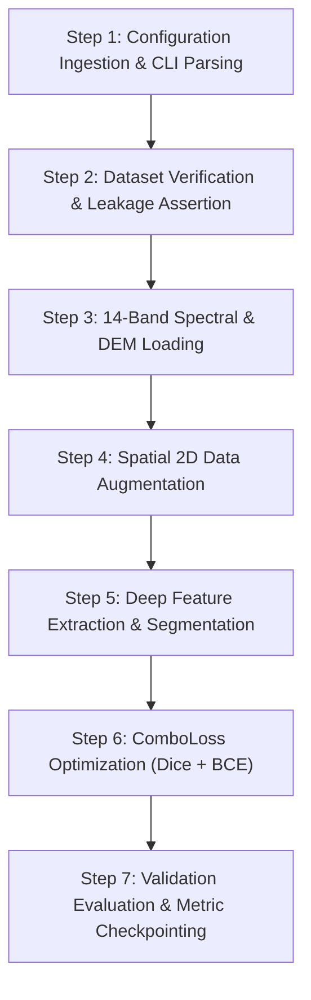

# Training Guide: Multi-Source Satellite Landslide Segmentation

This document describes how to execute the training workflow for the Landslide4Sense segmentation system and details the seven sequential processing stages executed under the hood.

---

## 1. How to Execute Training

The training system is implemented in PyTorch and supports multi-spectral Sentinel-2 and ALOS PALSAR topography data. Training can be initiated either via YAML configuration files or direct command-line arguments.

### Quick Start Commands

```bash
# Option A: Train via structured YAML configuration (Recommended)
python train.py --config configs/baseline_resunet.yaml
python train.py --config configs/fpn_resnet34.yaml
python train.py --config configs/unetplusplus_resnet34.yaml

# Option B: Direct CLI arguments (ResU-Net baseline)
python train.py --arch unet --encoder resnet34 --batch_size 16 --epochs 40 --lr 1e-4

# Option C: Multi-scale Feature Pyramid Network (FPN)
python train.py --arch fpn --encoder resnet34 --batch_size 16 --epochs 30 --lr 1e-4

# Option D: Nested Dense Skip Connections (UNet++)
python train.py --arch unetplusplus --encoder resnet34 --batch_size 16 --epochs 30 --lr 1e-4
```

### Essential Command-Line Arguments

- `--config <path>`: Path to a YAML configuration file under `configs/`. Command-line flags supersede YAML values.
- `--arch <name>`: Network architecture. Supported architectures: `unet`, `fpn`, `unetplusplus`, `deeplabv3plus`.
- `--encoder <name>`: Feature extraction backbone (default: `resnet34`).
- `--train_img_dir <path>`: Directory containing training satellite `.h5` files.
- `--train_mask_dir <path>`: Directory containing training ground-truth mask `.h5` files.
- `--val_img_dir <path>`: Directory containing validation satellite `.h5` files.
- `--val_mask_dir <path>`: Directory containing validation ground-truth mask `.h5` files.
- `--output_dir <path>`: Target root directory for checkpoints, CSV logs, and plots (default: `./results`).
- `--batch_size <int>`: Batch size per GPU forward pass (16 for 4GB VRAM, 32 for Colab 16GB T4).
- `--epochs <int>`: Total number of optimization epochs.
- `--lr <float>`: Initial learning rate for AdamW optimizer (default: `1e-4`).
- `--augment`: Enable online 2D spatial augmentation (random 90-degree rotations and horizontal/vertical flips).
- `--cache_data`: Cache pre-loaded arrays in host RAM to eliminate disk I/O bottlenecks.
- `--resume <path>`: Path to a checkpoint `.pth` file to resume interrupted training.

---

## 2. Training Execution Flow (Under the Hood)

When launching `train.py`, the pipeline executes the following 7-step sequence:



### Step 1: Configuration Ingestion and CLI Parsing
1. System reads arguments from `sys.argv` and checks whether a `--config` YAML file is supplied.
2. Merges configuration parameters, ensuring explicit CLI flags maintain strict priority over YAML defaults.
3. Initializes hardware execution context (`cuda` device detection and memory profiling).

### Step 2: Dataset Verification and Leakage Assertion
1. Discovers paired image-mask `.h5` files from training and validation directories.
2. Extracts sample basenames and executes a strict mathematical set-intersection assertion:
   $$\mathcal{S}_{train} \cap \mathcal{S}_{val} = \emptyset$$
3. Raises an immediate `ValueError` if any overlapping filenames are detected, preventing validation data contamination.

### Step 3: Multi-Source 14-Band Ingestion
For each sample, raw floating-point data of shape `(128, 128, 14)` is extracted:
- **Bands 1 to 12 (Sentinel-2 L2A Multispectral):** Aerosols, Blue, Green, Red, Red Edges (1-3), NIR, Narrow NIR, Water Vapour, and SWIR (1-2).
- **Band 13 (ALOS PALSAR Slope):** Topographical surface gradient.
- **Band 14 (ALOS PALSAR DEM):** Digital elevation model absolute terrain altitude.
- **Data Sanitization:** Replaces non-finite values (`NaN`, $+\infty$, $-\infty$) with $0.0$.
- **Tensor Transposition:** Re-orders dimensions from HWC to PyTorch standard CHW format `(14, 128, 128)`.

### Step 4: 2D Spatial Augmentation
When `--augment` is active during training:
1. Applies random horizontal reflection ($p = 0.5$).
2. Applies random vertical reflection ($p = 0.5$).
3. Applies random discrete orthogonal rotation $k \cdot 90^\circ$ ($k \in \{0, 1, 2, 3\}$).
4. Synchronizes spatial operations identically across image tensors and ground-truth masks while preserving radiometric spectral calibration.

### Step 5: Feature Extraction and Segmentation Head
1. The 14-channel tensor enters the convolutional encoder (e.g., ResNet-34).
2. The initial stem layer adapts 14 input channels into 64 internal feature maps without relying on RGB-only pre-trained assumptions.
3. Feature maps propagate across the 4 stages of residual blocks, downsampling spatially to $1/32$ resolution.
4. The decoder module (U-Net, FPN, UNet++, or DeepLabV3+) reconstructs high-resolution spatial details via lateral skip connections.
5. Produces raw logit outputs of shape `(Batch, 1, 128, 128)`.

### Step 6: Hybrid Loss Minimization
Due to extreme foreground-background class imbalance (landslide pixels represent $< 2\%$ of spatial area), a hybrid objective is computed:

$$\mathcal{L}_{Combo} = \alpha \cdot \mathcal{L}_{Dice} + (1 - \alpha) \cdot \mathcal{L}_{BCE}$$

- **Dice Loss ($\mathcal{L}_{Dice}$):**
  $$\mathcal{L}_{Dice} = 1 - \frac{2 \sum p_i y_i + \epsilon}{\sum p_i + \sum y_i + \epsilon}$$
- **Binary Cross Entropy with Logits ($\mathcal{L}_{BCE}$):**
  $$\mathcal{L}_{BCE} = -\frac{1}{N} \sum \left[ y_i \log(\sigma(z_i)) + (1 - y_i) \log(1 - \sigma(z_i)) \right]$$
- Gradients are backpropagated using AdamW ($\text{weight decay} = 10^{-4}$), with learning rate scheduled via Cosine Annealing over total epochs.

### Step 7: Validation Evaluation and Checkpointing
1. At the conclusion of each epoch, the model is switched to evaluation mode (`model.eval()`).
2. Evaluates the 245 validation tiles without gradient tracking.
3. Computes cumulative True Positives ($TP$), False Positives ($FP$), and False Negatives ($FN$) globally across the entire validation cohort to prevent batch-averaging bias.
4. Derives Precision, Recall, F1-Score, and Intersection over Union (IoU).
5. Compares current validation F1 against historical maximum. When an improvement is observed:
   - Serializes model weights, optimizer state, epoch index, and metric dictionary to `<model_tag>_best.pth`.
   - Appends performance telemetry to `<model_tag>_training_log.csv`.
